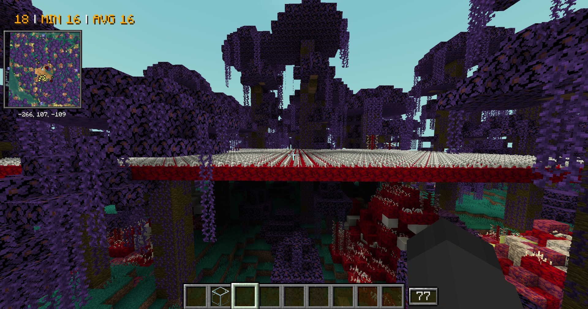
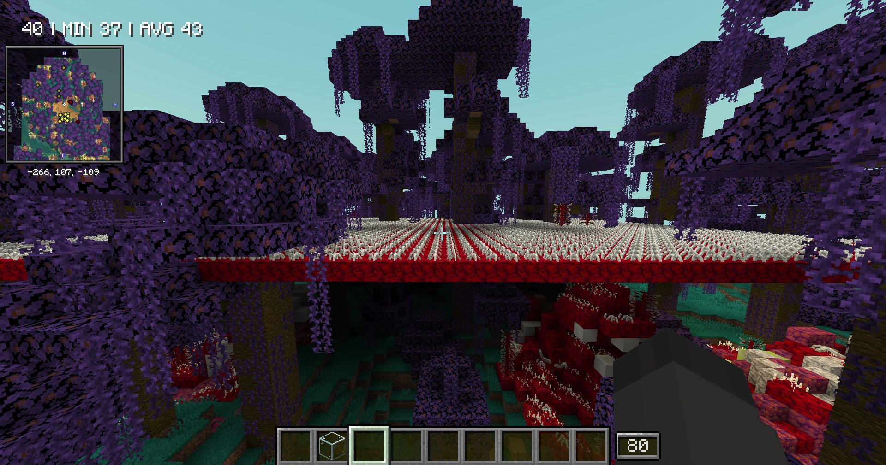
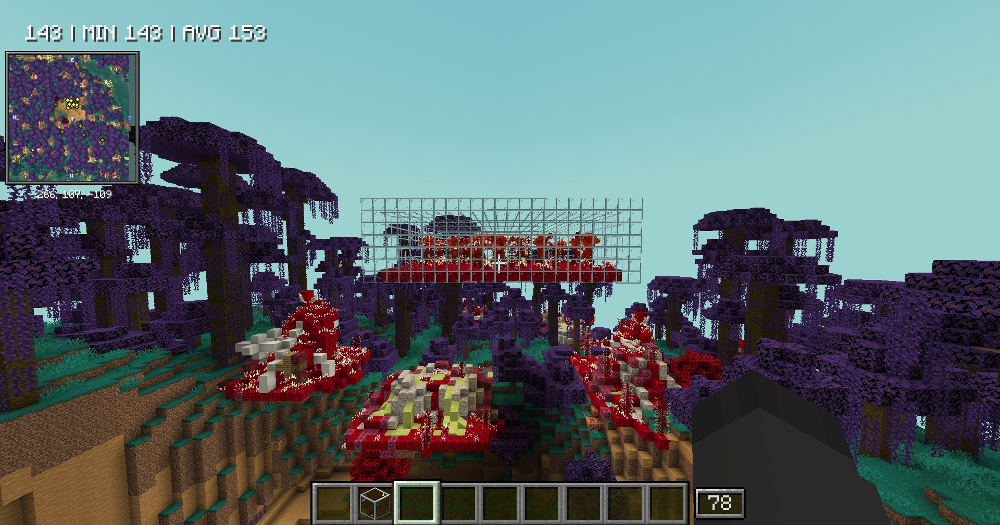
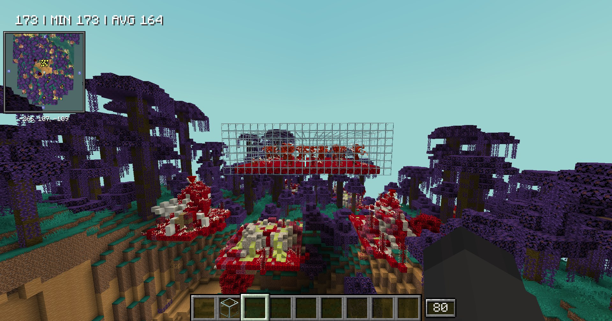

# TFTH Performance Fix (Unofficial Patch)

A companion mod for **The Flesh That Hates** 1.1b (Forge 1.20.1) that makes it <strong>run faster</strong> and <strong>fixes some of its bugs</strong>. <strong>The Flesh That Hates itself is still required.</strong>

***

## Requirements

<table>
  <tr>
    <th align="left">Requirement</th>
    <th align="left">Version</th>
  </tr>
  <tr>
    <td><strong>Minecraft</strong></td>
    <td>1.20.1 (Forge)</td>
  </tr>
  <tr>
    <td><strong>The Flesh That Hates</strong></td>
    <td><a href="https://www.curseforge.com/minecraft/mc-mods/the-flesh-that-hates">1.1b</a></td>
  </tr>
</table>

***

## Before And After

Same spot and settings, without the patch and then with it. The FPS counter is in the top left.

### A field of about 2,500 flesh spikes: 16 FPS to 43 FPS average

<table>
  <tr>
    <td align="center"></td>
    <td align="center"></td>
  </tr>
  <tr>
    <td align="center"><strong>Without</strong>: <strong>16 FPS</strong> average</td>
    <td align="center"><strong>With</strong>: <strong>43 FPS</strong> average</td>
  </tr>
</table>

### A pen full of flesh mobs: 153 FPS to 164 FPS average

<table>
  <tr>
    <td align="center"></td>
    <td align="center"></td>
  </tr>
  <tr>
    <td align="center"><strong>Without</strong>: <strong>153 FPS</strong> average</td>
    <td align="center"><strong>With</strong>: <strong>164 FPS</strong> average</td>
  </tr>
</table>

***

## Faster

*   **Flesh fog and flesh music** checks no longer read every block within 30 blocks of you. They skip the parts of the world with no flesh in them.
*   **Incubators** no longer read a whole box up to 251 blocks across for each mob they spawn, or go through every entity in the world to count their mobs.
*   **An incubator calling for help** no longer reads every block within 30 blocks to put out fire and lava.
*   **Infection spreads** do less work per block and keep their visited positions in about <strong>60 times less memory</strong>.
*   **Flesh spikes that aren't moving** are drawn from a recording instead of being rebuilt every frame.
*   **Flesh mobs, spikes, boils and the flesh forge** are drawn without sorting their faces every frame wherever their texture allows it, and look the same. With shader packs that light see-through mobs differently (Complementary does), those are now lit like other mobs. Faces with no area are no longer drawn.

## Bug Fixes

*   **Infection spreads survive restarts.** The Flesh That Hates saved them in a form it couldn't read back, so every spread was lost at each restart.
*   **Spreads stay in their own dimension** after a restart instead of moving to the Overworld.
*   **A spread pauses** while its chunk isn't loaded or no incubator is near it, waits at chunks that aren't loaded instead of loading them, and is removed once its origin block is gone.
*   **Incubators only spawn mobs, and new incubators only appear, in loaded chunks.** Before, they could load or generate chunks in the middle of a tick, which caused <strong>lag spikes</strong>.
*   **A starting incubator that evolves** no longer keeps its chunk loaded forever.
*   **No more "Modifier is already applied on this attribute!" crash** from the GOH effect.
*   **Brutes share damage** after the flesh stage damage reduction, not before it.
*   **Other players near flesh** no longer set your flesh fog or pause your music.
*   **The Flesh Unseen** is registered at its real size instead of 0 by 0. With Presence Footsteps, each Flesh Unseen searched an 81 by 81 block area under its feet for every step, which made the game <strong>stutter</strong>.

The log has one line for each patched part of The Flesh That Hates, saying how many changes applied.

***

## Credit

This is an **unofficial patch**, not affiliated with The Flesh That Hates. [The Flesh That Hates](https://www.curseforge.com/minecraft/mc-mods/the-flesh-that-hates) is made by WinVic.
